# Tsunagu

保護者面談の日程調整を自動化する、学校向けスケジューリングシステムです。

Tsunagu は **できる限り多くの家庭を自動で割り当てる** ことを目指し、
「きょうだいは連続した枠に」「特別支援学級は通常学級と連続した枠に」といった
学校現場特有の制約を同時に満たすスケジューリングアルゴリズムを実装しています。現役小学校教員としての実務経験をもとに設計し、現役教員の試用フィードバックを受けて画面を改善しました。

登録不要で、トップページの「デモを体験する（約5分）」から、担任・保護者・教頭先生の立場を切り替えながら、面談調整の6ステップを一通り体験できます。デモ開始時にデモ環境は初期状態に戻ります。

アプリケーションや実装内容は以下から確認できます。

- アプリケーション: https://tsunagu-app.com
- GitHub (フロントエンド): <https://github.com/yasuhiro-dev/tsunagu-frontend>
- GitHub (バックエンド): <https://github.com/yasuhiro-dev/tsunagu-backend>

## 目次

- [解決する課題](#解決する課題)
- [機能](#機能)
- [開発環境（ローカル）](#開発環境ローカル)
- [本番環境](#本番環境)
  - [インフラ構成図](#インフラ構成図)
- [ER図](#er図)
- [使用技術 (フロントエンド)](#使用技術-フロントエンド)
- [使用技術 (バックエンド)](#使用技術-バックエンド)
- [使用技術 (インフラ・その他)](#使用技術-インフラその他)
- [画面](#画面)
- [工夫した点](#工夫した点)
- [苦労した点・学んだこと](#苦労した点学んだこと)
- [テスト・静的解析](#テスト静的解析)
- [各種リンク](#各種リンク)

## 解決する課題

学校現場では、保護者との個人面談の日程調整を教員が手作業で行っています。Googleフォームなどの一般的な予約システムを使う学校もありますが、学校特有の条件までは対応しきれないのが実情です。

| 一般的な予約システム                                                                    | Tsunagu                                                                                                |
| --------------------------------------------------------------------------------------- | ------------------------------------------------------------------------------------------------------ |
| **きょうだいの面談がバラバラの日に**<br>個別予約のため、時間が揃わない                  | **きょうだいをまとめて配置**<br>自動で識別し、連続した時間に配置する                                   |
| **保護者の都合を伝えにくい**<br>空き枠から1つ選ぶ以外に方法がない                       | **保護者・教員双方の都合を考慮**<br>保護者が参加できる日時、教員が対応できない日時をもとに自動調整する |
| **複数の教員との調整が大変**<br>支援学級の児童は通常学級にも在籍するため、面談が2回必要 | **複数の教員の面談も自動調整**<br>2人の担任・2回の面談も、連続した枠を確保する                         |
| **早い者勝ちで不公平に**<br>予約が早い家庭だけが有利になる                              | **割り当ての難しい家庭を優先**<br>きょうだい・特別支援など、選べる枠が少ない家庭から先に確保する       |

Tsunagu は「学校特有の制約条件を尊重しながら、できる限り多くの家庭を自動で割り当てる」ことを軸に、機能・データ設計を行っています。条件が重なって配置できなかった家庭は、エラーにせず一覧で教員に返し、手動で調整できるようにしています。

## 機能

### 共通

- ログイン / ログアウト
- パスワードリセット（メールで再設定リンクを送信）
- ロール（保護者 / 教員 / 管理者）に応じて表示する画面・利用できるAPIを制限
- 各画面の「？」ボタンによる操作ガイド、デモ用の手順案内（6ステップ）

### 教員（担任）

- 面談に対応できない日時の登録（出張など。クラスの児童数から必要な面談枠数も表示）
- 児童一覧・未提出者の確認
- 未割り当て児童の確認と手動割り当て（保護者が提出した希望日時も表示）
- 面談表の手動調整（枠の移動・入れ替え）
  - きょうだい・特別支援学級の、他学級の面談表を閲覧
  - 連続しているきょうだい・特別支援学級の面談を動かそうとすると警告を表示（移動自体は可能）
- 面談表のPDF出力
- Googleアカウント連携（OAuth 2.0 / 面談確定メールを担任のGmailから送信するため）

### 保護者

- 児童の複数登録（きょうだい・特別支援学級への在籍に対応）
- 面談に参加できる日時の提出
- 調整中の状況・確定した面談日時の確認
- 面談日時のGoogleカレンダー登録（Googleアカウント連携後、ワンクリックで追加）

### 管理者（教頭先生）

- 教員・保護者アカウントの登録・編集・削除（検索 / 一括削除 / ページネーション）
- 提出締切日の設定
- 面談枠の一括自動割り当て（結果を見てやり直しも可能）
- 割り当て状況の可視化（全体・クラス別の割り当て率、きょうだいの連続面談の集計）
- 保護者への面談確定メールの一括送信（送信前に送信対象の一覧とメール文面を確認でき、送信済み・未送信を管理）

## 開発環境（ローカル）

このリポジトリはドキュメント専用です。ローカルで動かすには、[フロントエンド](https://github.com/yasuhiro-dev/tsunagu-frontend)・[バックエンド](https://github.com/yasuhiro-dev/tsunagu-backend)の2リポジトリを、それぞれ `meeting_front` / `interview_app` というフォルダ名でこのリポジトリ直下にクローンしてください。

<details>
<summary>起動手順を見る</summary>

```bash
git clone https://github.com/yasuhiro-dev/tsunagu.git
git clone https://github.com/yasuhiro-dev/tsunagu-frontend.git tsunagu/meeting_front
git clone https://github.com/yasuhiro-dev/tsunagu-backend.git tsunagu/interview_app
```

バックエンドの起動には `RAILS_MASTER_KEY` が必要です。`config/master.key` がない場合、Google連携・メール送信機能は動作しません。

### フロントエンド

面談枠の表示・割り当て結果の確認・保護者の希望日時入力などの画面を担当します。

```bash
docker compose up -d
docker compose exec next_container npm install
docker compose exec next_container npm run dev
```

- URL: <http://localhost:3001>

### バックエンド

認証、面談枠の自動割り当てロジック、PDF出力、Google連携（Gmail / カレンダー）などのAPIを提供します。

```bash
docker compose up -d
docker compose exec rails_container bundle install
docker compose exec rails_container bin/rails db:create db:migrate db:seed
```

- Rails API: <http://localhost:3000>
- `docker-compose.yml` で `SOLID_QUEUE_IN_PUMA: "true"` を指定しているため、solid_queue のワーカー（メール送信ジョブ）は Puma と同じプロセスで起動します。

</details>

## 本番環境

本番環境では、フロントエンド（Next.js）とバックエンド（Rails API）を別々の形で運用しています。

- Next.js は静的サイトとしてビルドし、**S3** に置いて配信
- Rails API は Docker イメージ化し、**ECS Fargate** 上のコンテナとして実行

### 構成するAWSサービス

- Route 53 - DNS
- ACM - HTTPS証明書
- CloudFront - CDN配信・パスベースルーティングによるフロント/バックエンドの振り分け
- S3 - Next.js静的ファイルの配置
- ALB - Rails APIへのリクエストをECS Fargateタスクへ分散
- ECS Fargate - Rails API のコンテナ実行
- Amazon RDS for MySQL - データベース
- ECR - Dockerイメージ管理
- GitHub Actions - CI/CD

### インフラ構成図

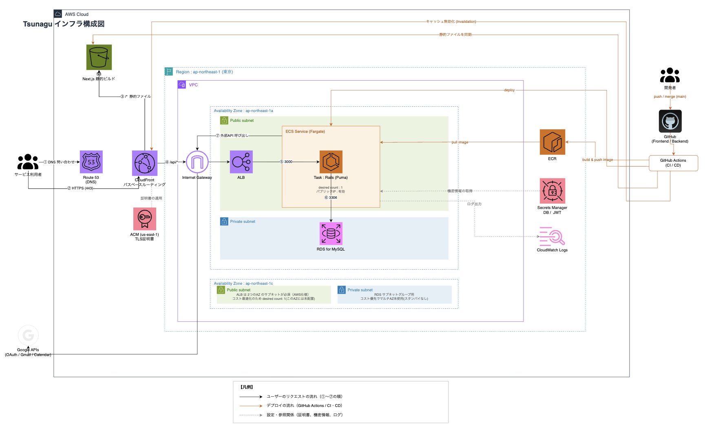

_図をクリックすると拡大表示できます_

### リクエストの流れ

1. ユーザーは独自ドメイン（`tsunagu-app.com`）にHTTPSでアクセスします。
2. リクエストはCloudFrontに届き、パスパターンによって振り分けられます。
3. `/api/*` にマッチするリクエストは、ALBを経由してRails API（ECS Fargate）に転送されます。
4. それ以外のリクエストは、S3に配置されているNext.jsの静的ファイルがそのまま返されます。

### 外部連携

- Gmail API: 面談確定メールを、担任のGmailアカウントから保護者へ送信する際に利用します。
- Google Calendar API: 保護者の面談日程をGoogleカレンダーへ登録する際に利用します。
- OAuth 2.0（Google）: 教員・保護者アカウントとGoogleアカウントの連携に利用します。

### デプロイの流れ

`main` ブランチへの push を GitHub Actions が検知し、以下を実行します。

- フロントエンド: Next.jsを静的ビルドし、S3へアップロード
- バックエンド: Dockerイメージを ECR へ push したうえで、ECS Fargate サービスへデプロイ

いずれの場合もCloudFrontのキャッシュを適宜無効化し、最新の内容が反映されるようにしています。

## ER図

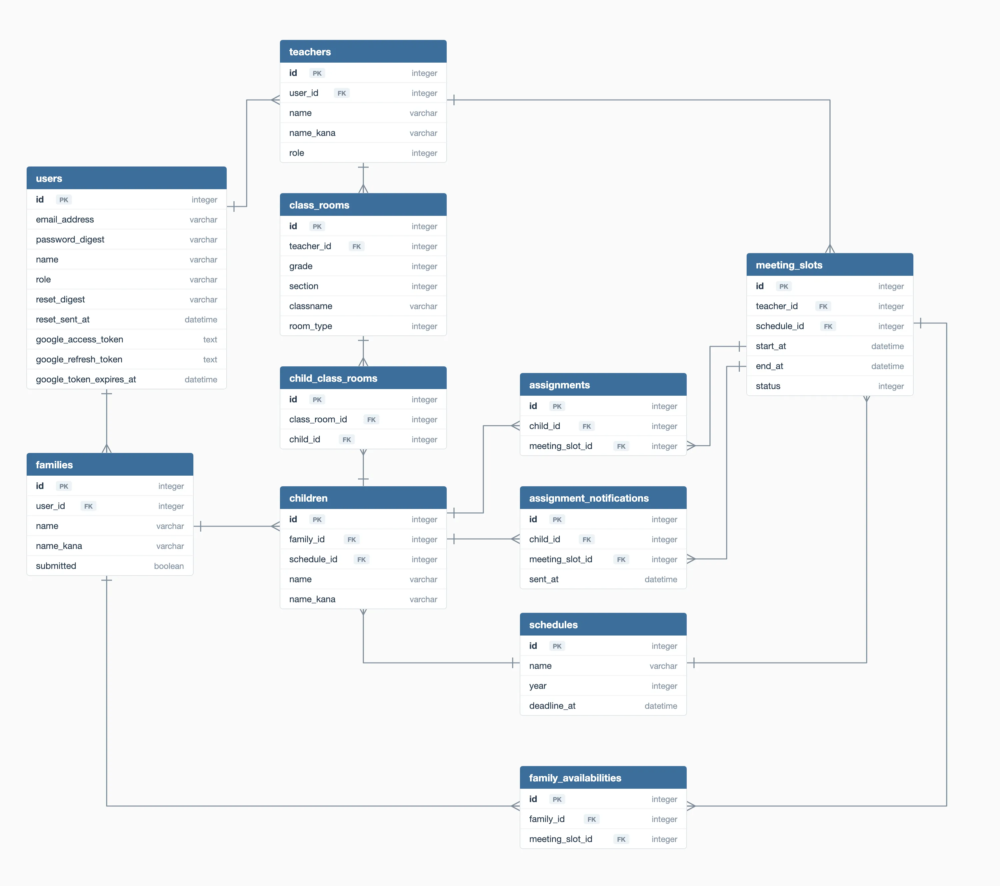

| テーブル                   | 役割                                                                              |
| -------------------------- | --------------------------------------------------------------------------------- |
| `users`                    | 認証情報。Googleカレンダー連携用のトークンも保持                                  |
| `teachers`                 | 教員のプロフィール情報                                                            |
| `families`                 | 保護者のプロフィール情報                                                          |
| `children`                 | 児童情報                                                                          |
| `class_rooms`              | クラス情報。担任の教員に紐づく                                                    |
| `child_class_rooms`        | 児童の所属クラス。複数クラスに所属できる（通常学級と特別支援学級の在籍に対応）    |
| `schedules`                | 面談を実施する期間の設定                                                          |
| `meeting_slots`            | 面談枠。日時ごとに区切られた1コマ。状態（空き / 予約済み / 教員が対応不可）を持つ |
| `assignments`              | 面談枠に割り当てられた児童の記録                                                  |
| `family_availabilities`    | 保護者が提出した、面談に参加できる日時                                            |
| `assignment_notifications` | 面談確定メールの送信記録（同じ割り当てに二重送信しないため）                      |

## 使用技術 (フロントエンド)

| 技術                                                                 | バージョン / 補足            |
| -------------------------------------------------------------------- | ---------------------------- |
| [Next.js](https://nextjs.org/docs)                                   | 16.x                         |
| [React](https://react.dev/)                                          | 19.x                         |
| [TypeScript](https://www.typescriptlang.org/)                        | 5.x                          |
| [MUI](https://mui.com/)                                              | v9                           |
| [MUI X Charts](https://mui.com/x/react-charts/)                      | 割当状況の可視化に使用       |
| [fetch API](https://developer.mozilla.org/ja/docs/Web/API/Fetch_API) | APIリクエスト（Next.js標準） |
| [ESLint](https://eslint.org/)                                        | 静的解析                     |

## 使用技術 (バックエンド)

| 技術                                                                             | バージョン / 補足                        |
| -------------------------------------------------------------------------------- | ---------------------------------------- |
| [Ruby](https://www.ruby-lang.org/)                                               | 3.3.x                                    |
| [Rails](https://rubyonrails.org/)                                                | 8.1.x / API mode                         |
| [MySQL](https://www.mysql.com/) / [mysql2](https://github.com/brianmario/mysql2) | 8.0（本番：Amazon RDS）                  |
| [jwt](https://github.com/jwt/ruby-jwt)                                           | 認証（自前実装、有効期限30分）           |
| [bcrypt](https://github.com/bcrypt-ruby/bcrypt-ruby)                             | パスワードのハッシュ化                   |
| [oauth2](https://github.com/oauth-xx/oauth2)                                     | Google OAuth 2.0連携                     |
| [Grover](https://github.com/Studiosity/grover)                                   | PDF生成（Puppeteer + Chromium）          |
| [RSpec Rails](https://github.com/rspec/rspec-rails)                              | テスト                                   |
| [RuboCop](https://rubocop.org/)                                                  | 静的解析                                 |
| [Brakeman](https://brakemanscanner.org/)                                         | セキュリティ静的解析                     |
| [bundler-audit](https://github.com/rubysec/bundler-audit)                        | 依存gemの脆弱性チェック                  |
| [Gmail API](https://developers.google.com/gmail/api)                             | 面談確定メール送信                       |
| [Google Calendar API](https://developers.google.com/calendar)                    | 面談日程のカレンダー登録                 |
| [solid_queue](https://github.com/rails/solid_queue)                              | 非同期ジョブ（面談確定メールの一括送信） |

## 使用技術 (インフラ・その他)

| 技術                                                                                                                     | 用途                                                  |
| ------------------------------------------------------------------------------------------------------------------------ | ----------------------------------------------------- |
| [Amazon S3](https://docs.aws.amazon.com/AmazonS3/latest/userguide/Welcome.html)                                          | Next.js 静的ファイルの配置                            |
| [AWS ECS Fargate](https://docs.aws.amazon.com/AmazonECS/latest/developerguide/AWS_Fargate.html)                          | Rails API のコンテナ実行                              |
| [ALB (Application Load Balancer)](https://docs.aws.amazon.com/elasticloadbalancing/latest/application/introduction.html) | Rails API へのリクエストをECS Fargateタスクへ分散     |
| [Amazon CloudFront](https://docs.aws.amazon.com/AmazonCloudFront/latest/DeveloperGuide/Introduction.html)                | CDN配信・パスベースルーティングによるS3/ALBの振り分け |
| [Amazon RDS for MySQL](https://docs.aws.amazon.com/AmazonRDS/latest/UserGuide/CHAP_MySQL.html)                           | 本番DB                                                |
| [Route 53](https://docs.aws.amazon.com/Route53/latest/DeveloperGuide/Welcome.html)                                       | DNS                                                   |
| [ACM](https://docs.aws.amazon.com/acm/latest/userguide/acm-overview.html)                                                | HTTPS証明書                                           |
| [ECR](https://docs.aws.amazon.com/AmazonECR/latest/userguide/what-is-ecr.html)                                           | Dockerイメージ管理                                    |
| [GitHub Actions](https://docs.github.com/en/actions)                                                                     | CI/CD                                                 |
| [Docker / Docker Compose](https://docs.docker.com/)                                                                      | 開発環境                                              |

## 画面

### トップページ

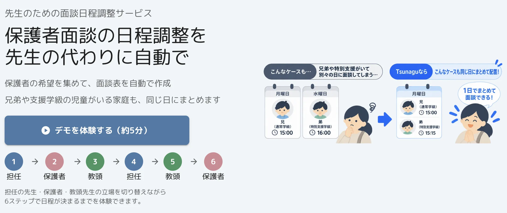

トップページでは、アプリの概要と主要導線が分かるようにしています。

### 面談枠の自動割り当て

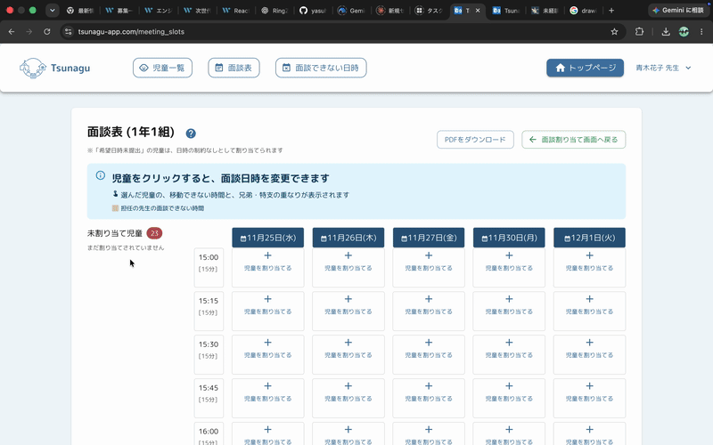

きょうだいの連続配置・特別支援学級との調整など、制約条件を踏まえて面談枠を自動で割り当てます。

<details>
<summary>その他の画面キャプチャを見る</summary>

### 保護者の希望日時提出

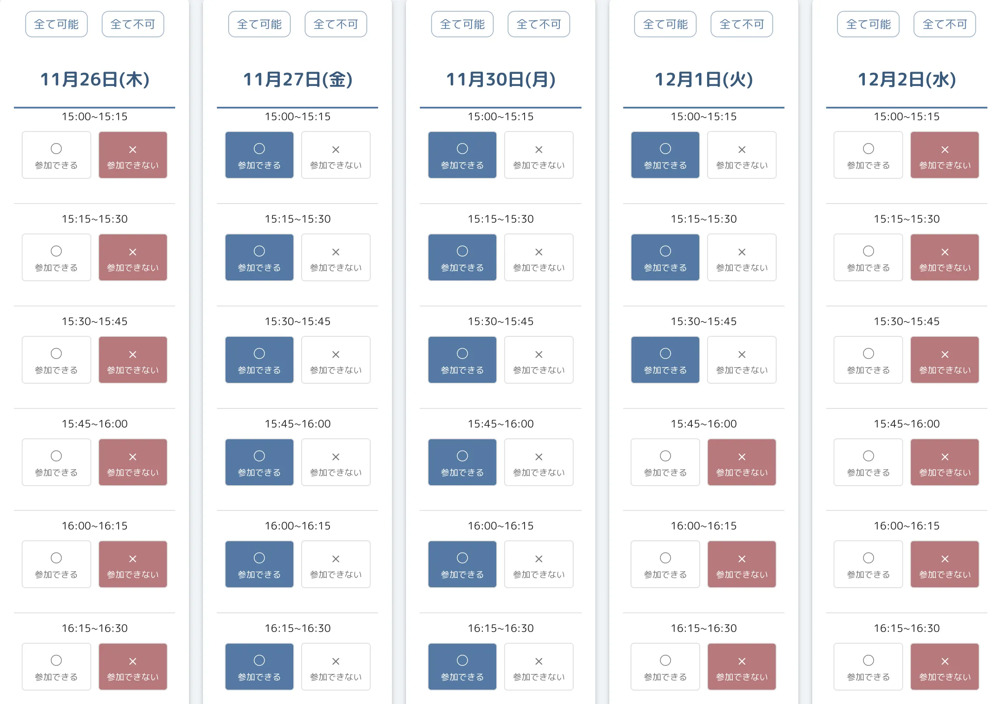

提示された面談枠のうち、参加できる枠をWeb上で選択して提出します。

### 確定した面談日程の確認

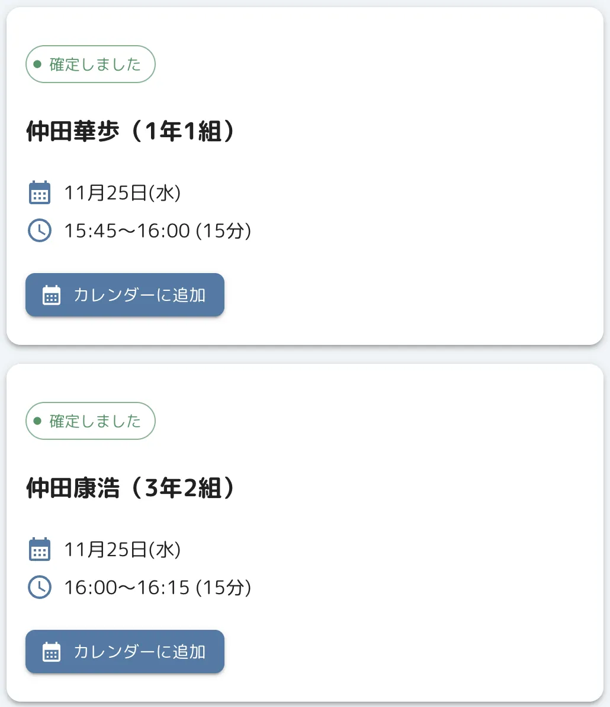

保護者が自分の子どもの面談日時を確認し、ワンクリックでGoogleカレンダーに登録できます。

### 面談表PDF出力

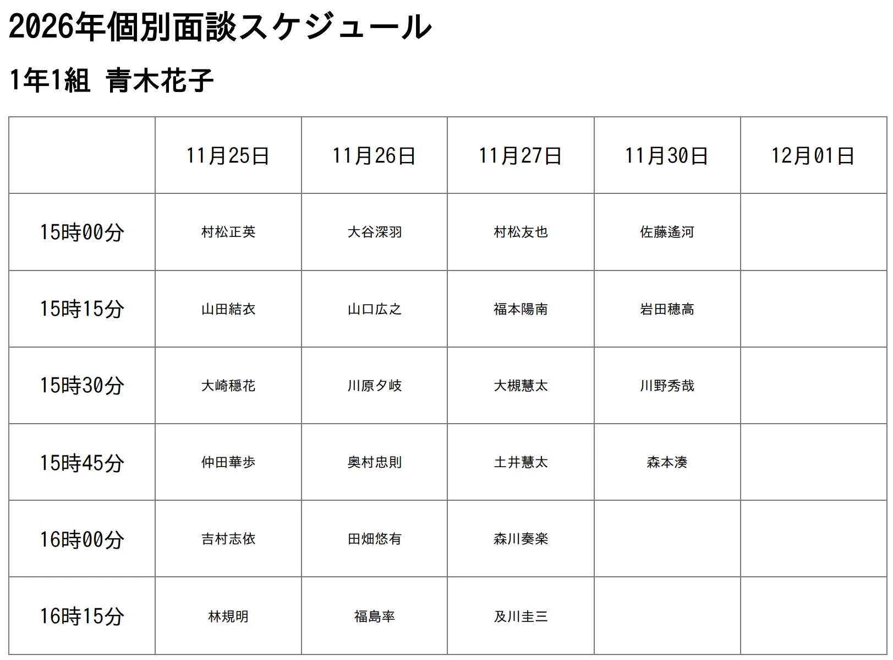

割り当て結果を、先生が確認・共有しやすいPDF形式で出力できます。

### 管理画面

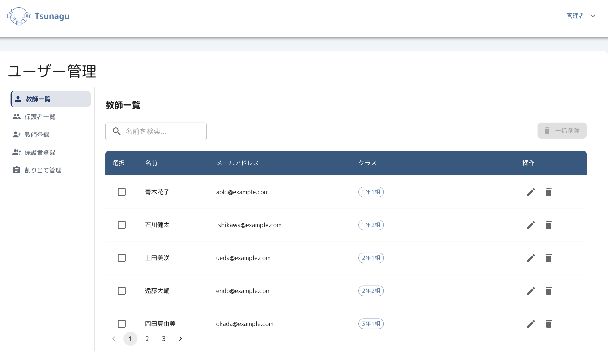

教員アカウントの検索・一括削除

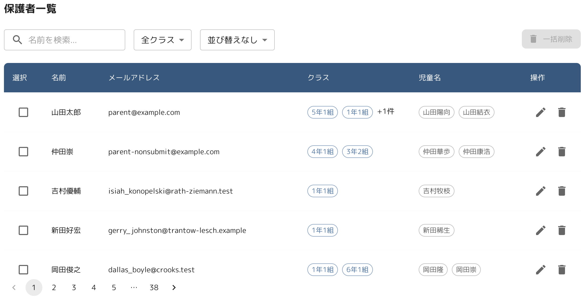

保護者アカウントの検索・一括削除（クラス絞り込み対応）

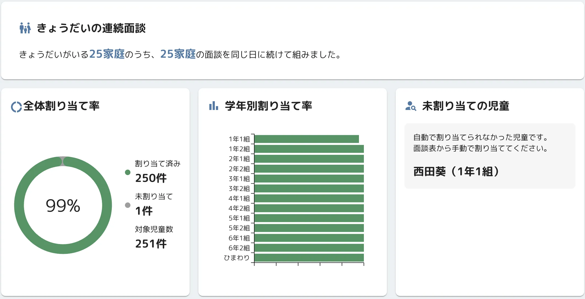

全体・クラスごとの割り当て率と、きょうだいの連続面談の集計を確認できます。

### ログイン

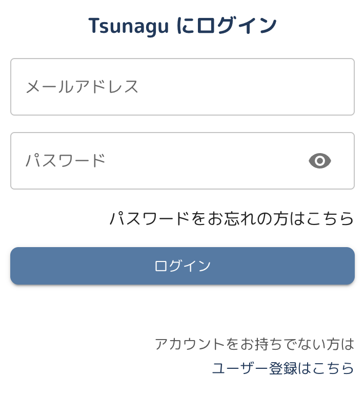

### 新規登録

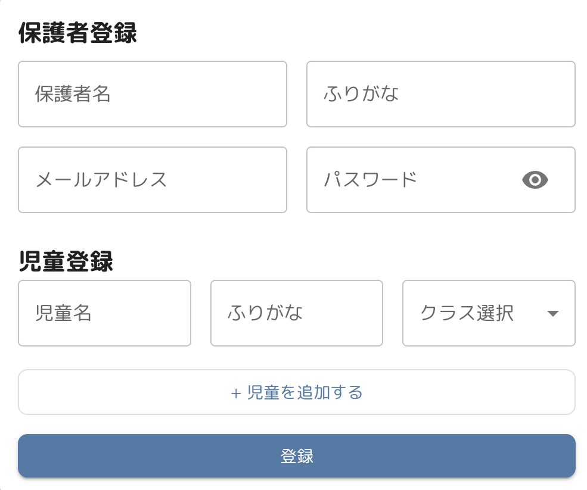

児童の複数登録に対応しています。

### パスワードリセット

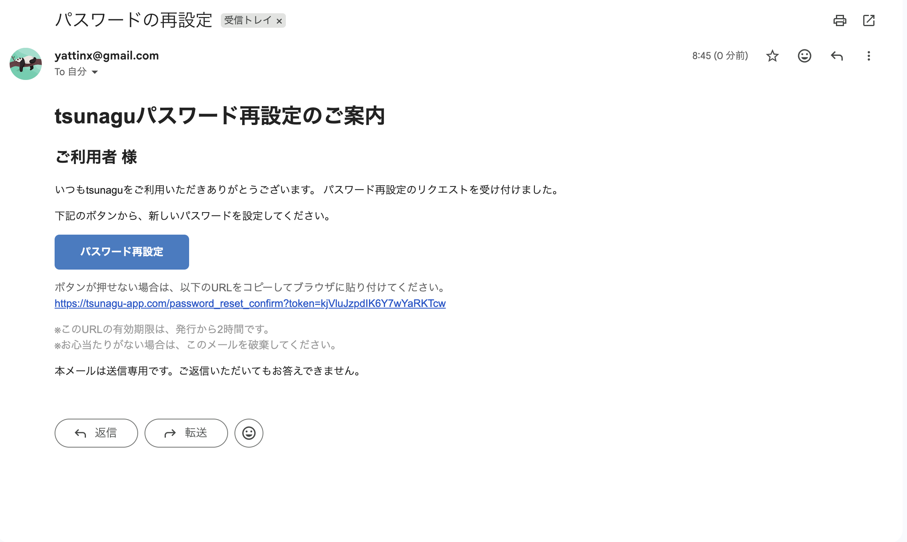

メールアドレスを入力してリセットを申請すると、再設定用のリンクをメールで送信します。
リンクから遷移して新しいパスワードを設定すると完了です。

</details>

## 工夫した点

### 1. 割り当ての難しい家庭から優先して枠を決める設計

きょうだいや特別支援学級の児童など、連続した枠が必要な家庭を後回しにすると、条件に合う枠が残らなくなります。そこで家庭ごとに割り当ての難しさを点数化し、点数の高い順に割り当てる方式にしました。

割り当てアルゴリズムは、次の4条件を同時に満たす必要があります。

- 限られた面談枠の中で、できる限り多くの家庭を割り当てる
- 保護者が参加できると答えた日時にだけ割り当てる（未提出の家庭は日時の制約なしとして扱う）
- きょうだいは連続した枠に配置する（例：兄が5年2組の枠 → 弟が3年2組の枠）
- 特別支援学級の児童は、通常学級の面談と連続した枠に配置する（例：3年1組の枠 → ひまわり学級の枠）

| 条件                     | 点数 | 理由                                                                          |
| ------------------------ | :--: | ----------------------------------------------------------------------------- |
| きょうだいがいる         |  +4  | 連続2枠が必要。担任2人とも通常学級（30人前後）で空き枠が重なりにくい          |
| 特別支援学級を含む       |  +2  | 同じく連続2枠が必要だが、少人数学級のため、きょうだいのケースより選択肢は多い |
| 参加できる日時を提出済み |  +1  | 連続枠は不要だが、候補が提出した時刻の枠に限られる                            |

合計点の高い順に処理します。児童約250名分のテストデータで、未割り当て0件を確認しています。なおデモ環境では、手動割り当てを体験できるよう、意図的に自動では入らない児童を用意しています。

割り当ては貪欲法で実装しており、一度決めた配置は後から変更しません。配置に失敗したときに前の判断まで戻ってやり直す方式にすればより多くの家庭を配置できますが、実装が複雑になるため、今回の規模では貪欲法で実用に足ると判断しました。その代わり、条件が重なって割り当てられない家庭が出た場合はエラーにせず一覧で表示し、教員が手動で調整できるようにしています。

処理は `ScheduleAssigner` を起点に、`GroupChildren` → `PrioritySort` → `AvailableSlots` → `TimeFilter` → `SiblingsFilter` → `SupportFilter` → `Assigner` の各クラスへ委譲する構成にし、1クラス1責務でそれぞれ独立してテストできるようにしています。

### 2. 現役教員の意見をもとに、手動調整の画面を改善

現役教員に試用してもらい、「きょうだいの枠がどこにあるかわからないと動かせない」という指摘を受けました。そこで面談表の調整画面から、きょうだいや特別支援学級といった他学級の面談表を閲覧できるようにし、連続しているきょうだいの面談を動かそうとすると警告を出すようにしました。

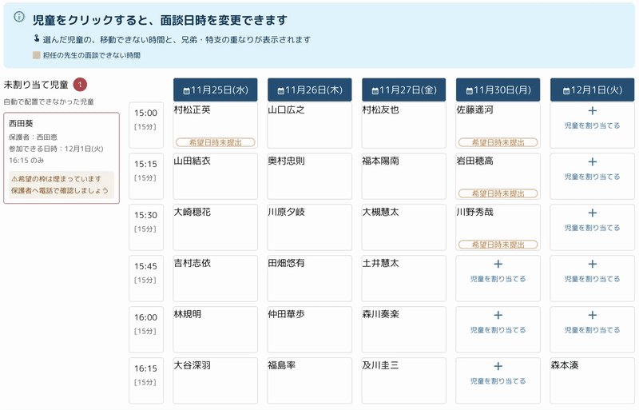

現場では急な日程変更が多いため、移動自体は禁止せず、最終判断は教員に委ねています。

## 苦労した点・学んだこと

### 割り当てが失敗してしまう不具合

面談枠を3つ必要とする家庭のみ割り当てに失敗する不具合がありました。`SiblingsFilter`（きょうだいの連続配置）と `SupportFilter`（特別支援学級の連続配置）の間で、枠の並び条件の前提が噛み合っていなかったことが原因でした。

<details>
<summary>調査の流れを見る</summary>

**症状**:面談自動割り当てボタンを押しても、一部の児童が割り当てられず、未割り当てになってしまう状態がありました。

**切り分け**:まずはタイポや実装ミスを疑い、フロントエンド・バックエンド双方のコードを確認しましたが、明確なエラーは見つかりませんでした。次に、どのパターンで失敗するのかを切り分けたところ、面談枠を2つ必要とする家庭は割り当てに成功する一方、3つ必要とする家庭のみ失敗していることが分かりました。

**仮説**:面談枠の割当ロジックを担当するサービスクラス（`SiblingsFilter`：きょうだいの連続配置、`SupportFilter`：特別支援学級の連続配置）に当たりをつけました。

**原因**:ログを仕込んで中間データを確認したところ、`SiblingsFilter` が返す枠の並びと、`SupportFilter` が前提とする並び条件が噛み合っていないことが原因だと判明しました。

**再発防止**:`SiblingsFilter` 側で特別支援学級の枠がきょうだいの通常学級枠と連続するよう条件を追加した結果、割り当ては安定し、問題を解消することができました。

</details>

**学び**：単独ファイルの中だけで実装を考えるのではなく、フィルタをまたいだ処理の流れ全体で条件を統一し、一貫性を持たせておくことの必要性を学びました。

### 割当処理のレスポンス速度改善（solid_queue による非同期化と N+1 解消）

面談自動割り当てを実行すると完了までに約82秒かかる状態でしたが、確認メール送信の同期実行と N+1 問題という2つの原因を特定・解消し、約8秒まで短縮しました。

<details>
<summary>調査の流れを見る</summary>

**症状**:面談自動割り当てを実行すると、完了までに約82秒かかる状態でした。

**切り分け**:CloudWatch のログを確認すると、1回のリクエストで4,453件もの SQL クエリが発行されており、該当箇所のコードで N+1 問題を調査していたところ、同じ処理の中で確認メール送信も呼ばれていることに気づきました。

**仮説**:実際に仮のメールアドレスで受信を確認したところ、メールの受信に時間がかかっていることが分かり、外部API（Gmail API）への同期呼び出しが原因の一つではないかと考えました。

**原因**:原因を整理すると、①確認メール送信が割当処理と同じリクエスト内で同期的に実行されていたこと、②`includes` 済みの関連に `.where` や `.pluck` をチェーンしたことで事前読み込みが無効化され、N+1 が発生していたこと、の2点でした。

**再発防止**:まず確認メール送信を solid_queue で非同期化したところ約82秒から約10秒まで短縮され、その後 `.where` を `find { }` に、`.pluck` を `.map` に置き換え、事前読み込み済みのデータから取得する形にしたことで、約10秒から約8秒までさらに短縮されました。

なお現在は、面談確定メールを割り当て直後に送るのではなく、管理者が割り当て結果を確認してから一括送信する方式に変更しています（送信は引き続き solid_queue のジョブで実行）。

</details>

**学び**：外部APIへの通信は結果をすぐ必要としない処理なら非同期化できること、そして `includes` は書いた時点で安心せず、後続で `.where` や `.pluck` をチェーンしていないか確認する必要があることを学びました。

## テスト・静的解析

```bash
# Rails
docker compose exec rails_container env RAILS_ENV=test bundle exec rspec
docker compose exec rails_container bundle exec rubocop
docker compose exec rails_container bundle exec brakeman

# Next.js
docker compose exec next_container npm run lint
```

CI では、バックエンドで RSpec（28ファイル / リクエストスペック17・サービススペック9・メーラースペック1・ジョブスペック1）・RuboCop・Brakeman・bundler-audit を、フロントエンドで ESLint・型チェック（npm run build）・npm audit を実行しています。
割り当てロジックは8クラスすべてに個別のスペックを用意し、条件ごとの挙動を独立して検証しています。

## 各種リンク

- アプリケーション: https://tsunagu-app.com
- GitHub (フロントエンド): <https://github.com/yasuhiro-dev/tsunagu-frontend>
- GitHub (バックエンド): <https://github.com/yasuhiro-dev/tsunagu-backend>
